# A380X Virtual Crew - User Manual

The virtual crew gives you a first officer who flies the FBW A380X with you, following the FBW A380X Standard
Operating Procedures (SOP). You are the **pilot flying (PF)** and the virtual first officer is the **pilot monitoring
(PM)**. The first officer:

- prepares the cockpit during a 40 minute preflight
- performs the flows of the SOP (lights, transponder, TCAS, ground spoilers, autobrake, flaps, APU after landing...)
- reads the normal checklists of the ECL and checks them on the ECAM
- makes the standard callouts ("Thrust set", "V1", "Positive climb", "Transition", "Localizer alive", "Reverse
  green"...) and crosschecks the altimeter settings
- executes your orders ("Gear up", "Flaps one", "Gear down"...) and confirms them
- answers your takeoff and approach briefings

You drive the crew with **two buttons** of your controller and with the **Crew page** of the flyPad.

> [!NOTE]
> The virtual crew is a button operated crew: it does not use speech recognition. Everything you say is played by the
> captain voice when you press the primary button.

## Contents

- [1. Getting started](#1-getting-started)
  - [1.1 Enable the virtual crew](#11-enable-the-virtual-crew)
  - [1.2 Select the voices](#12-select-the-voices)
  - [1.3 Select the SSR policy](#13-select-the-ssr-policy)
  - [1.4 Bind the buttons](#14-bind-the-buttons)
  - [1.5 Test the cockpit controls](#15-test-the-cockpit-controls)
- [2. The buttons](#2-the-buttons)
- [3. The Crew page](#3-the-crew-page)
- [4. Flying a complete flight](#4-flying-a-complete-flight)
  - [4.1 Preflight](#41-preflight)
  - [4.2 Takeoff briefing](#42-takeoff-briefing)
  - [4.3 Before start and engine start](#43-before-start-and-engine-start)
  - [4.4 After start and flight control check](#44-after-start-and-flight-control-check)
  - [4.5 Taxi and brake check](#45-taxi-and-brake-check)
  - [4.6 Before takeoff and line-up](#46-before-takeoff-and-line-up)
  - [4.7 Takeoff](#47-takeoff)
  - [4.8 Climb and cruise](#48-climb-and-cruise)
  - [4.9 Approach briefing and descent](#49-approach-briefing-and-descent)
  - [4.10 Approach and landing](#410-approach-and-landing)
  - [4.11 Go-around](#411-go-around)
  - [4.12 After landing, parking and securing](#412-after-landing-parking-and-securing)
- [5. Checklists](#5-checklists)
- [6. Briefings](#6-briefings)
- [7. Callouts](#7-callouts)
- [8. What remains your job](#8-what-remains-your-job)
- [9. Troubleshooting](#9-troubleshooting)
- [10. Reference for external tools](#10-reference-for-external-tools)

## 1. Getting started

All settings are on the flyPad: **Settings > Virtual Crew**. They are saved and kept between flights.

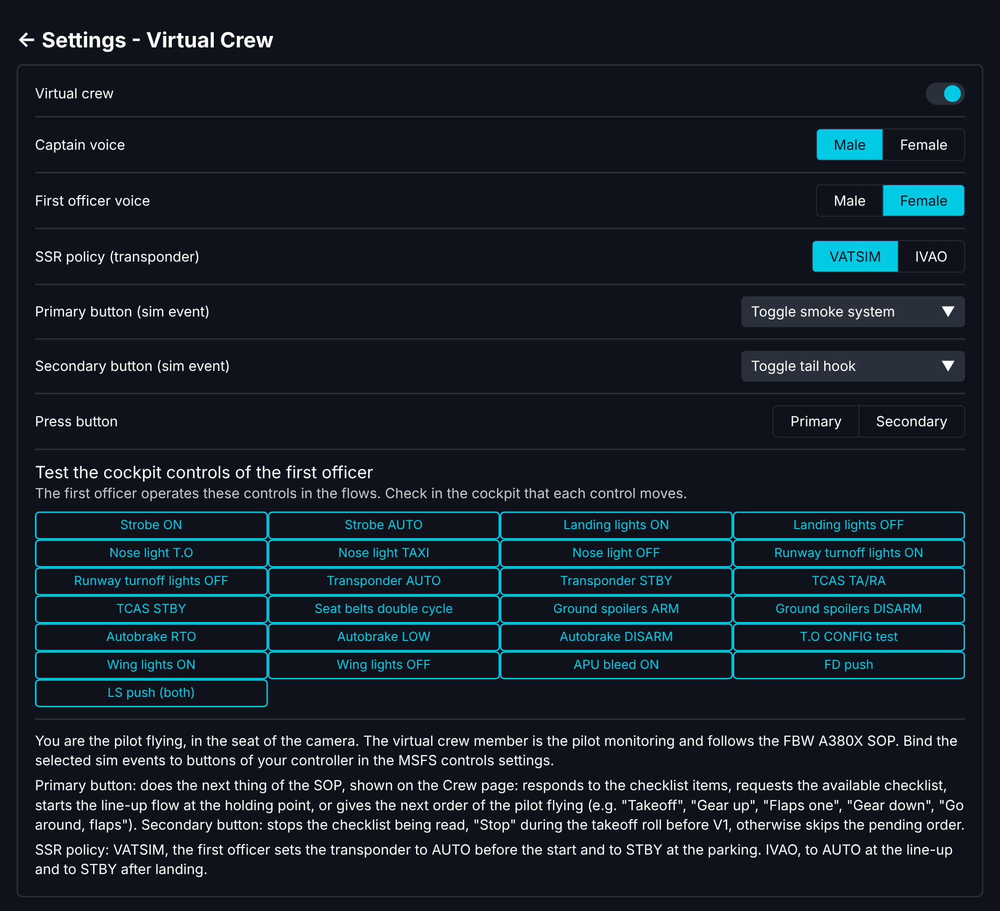

### 1.1 Enable the virtual crew

Turn on the **Virtual crew** toggle. While it is off, the Crew page only shows a link to this setting, and the first
officer does nothing.

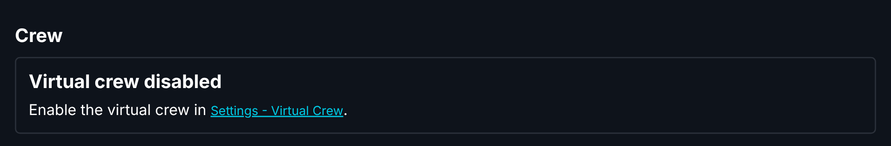

### 1.2 Select the voices

Select a **Male** or **Female** voice for the captain (your voice) and for the first officer. By default the captain
is male and the first officer is female, so the two can be told apart.

### 1.3 Select the SSR policy

The **SSR policy (transponder)** follows the rules of the online network you fly on:

| Policy | Transponder AUTO | Transponder STBY |
|--------|------------------|------------------|
| **VATSIM** (default) | before start flow, once the beacon is ON | after the engine shutdown, at the parking |
| **IVAO** | line-up flow, at the holding point | after landing flow, once the runway is vacated |

### 1.4 Bind the buttons

The virtual crew listens to two sim events that have no function in the A380X. Select one for each button:

| flyPad option          | Sim event                  | Name in the MSFS controls settings |
|------------------------|----------------------------|------------------------------------|
| Toggle smoke system    | `SMOKE_TOGGLE`             | Toggle smoke system                |
| Toggle tail hook       | `TOGGLE_TAIL_HOOK_HANDLE`  | Toggle tail hook                   |
| Toggle wing fold       | `TOGGLE_WING_FOLD`         | Toggle wing fold                   |
| Toggle water rudders   | `TOGGLE_WATER_RUDDER`      | Toggle water rudders               |

1. On the flyPad, select a sim event for the **Primary button** and a different one for the **Secondary button**,
   e.g. *Toggle smoke system* and *Toggle tail hook*.
2. In MSFS, open **Options > Controls**, select your joystick or throttle, search for the same names and assign a
   button to each.
3. Back on the flyPad, use **Press button > Primary / Secondary** to check the crew reacts without your controller.

> [!TIP]
> Choose buttons you can reach without looking, on the throttle or the sidestick: you will use the primary button
> for every checklist response and every order, including during the takeoff roll and the approach.

### 1.5 Test the cockpit controls

The grid **Test the cockpit controls of the first officer** operates, one by one, every control the first officer
uses in the flows (strobe, landing and nose lights, runway turnoff lights, transponder, TCAS, seat belts, ground
spoilers, autobrake, T.O CONFIG, wing lights, APU bleed, FD and LS). Press a button and check in the cockpit that the
switch moves. This is useful after an update of the aircraft, or if a flow seems to leave a switch in the wrong
position.

## 2. The buttons

| Button        | What it does                                                                                       |
|---------------|----------------------------------------------------------------------------------------------------|
| **Primary**   | Does the **next thing of the SOP**. The Crew page always shows what it will do ("Primary button: ..."): respond to the checklist item being read, request the next checklist, start the flight control check or the brake check, start the line-up flow, announce the takeoff, give the next order (gear, flaps, go-around), or call "Taxi lights off" after landing. |
| **Secondary** | **Stops or skips**: stops the checklist being read, skips the flight control check or the brake check, calls **"Stop!"** during the takeoff roll before V1 (rejected takeoff), otherwise skips the pending order. |

When you press the primary button for an order, your captain voice gives the order, the first officer executes it and
confirms. If you already did it yourself (e.g. you moved the flaps lever), the order is skipped.

> [!TIP]
> When unsure, look at the **Primary button** line of the Crew page: it is the single source of truth for what will
> happen next. "Nothing to do" means the crew is waiting for the aircraft (a phase change, a speed, an altitude...).

## 3. The Crew page

The Crew page (flyPad **Crew** tab) shows the state of the crew and contains the briefings.

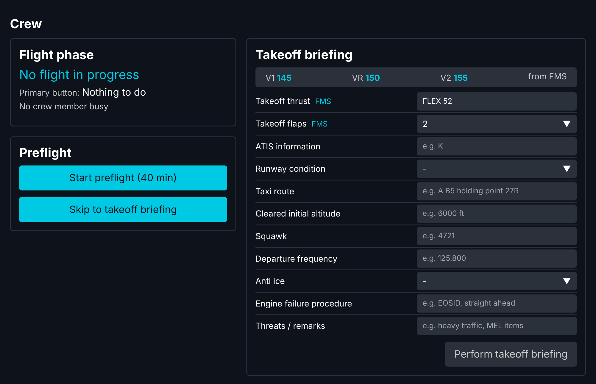

- **Flight phase**: the current phase of the SOP, the action of the **primary button**, the workflow or flow the crew
  member is busy with, and the checklist being read.
- **Preflight** (before the flight) or **Flight** (afterwards): the preflight countdown and schedule, then the list of
  phases, the past ones in green and the current one highlighted.
- **Takeoff briefing** / **Approach briefing**: the briefing cards, shown when the briefing can be performed. Once
  performed, the card is replaced by a green "... briefing performed" badge at the top.
- **End flight**: ends the flight at any time and clears both briefings. Use it to start again from the beginning,
  e.g. after a reload of the flight.

## 4. Flying a complete flight

The phases follow the chapters of the SOP. The crew changes phase on its own, from the state of the aircraft: you
only need to fly and press the primary button when the Crew page proposes something.

| Phase                    | Starts when                                         | First officer (automatic)                                  | Primary button                           |
|--------------------------|-----------------------------------------------------|------------------------------------------------------------|------------------------------------------|
| Preflight                | *Start preflight* on the Crew page                   | preflight workflows at their scheduled time                 | COCKPIT PREPARATION C/L                  |
| Takeoff briefing         | *Skip to takeoff briefing*                           |                                                            |                                          |
| Before pushback or start | end of the preflight, or the briefing performed     | transponder AUTO (VATSIM; after the C/L, beacon ON)         | BEFORE START C/L                         |
| Engine start             | engine mode selector IGN START                      | engine start callouts                                      |                                          |
| After start              | engine mode selector back to NORM                   | ground spoilers ARM, flaps as briefed, autobrake RTO, THS  | AFTER START C/L, flight control check    |
| Taxi                     | parking brake released and moving                   |                                                            | brake check, TAXI C/L, line-up flow      |
| Before takeoff           | line-up flow requested at the holding point          | line-up flow                                               | LINE-UP C/L, announce takeoff            |
| Takeoff                  | takeoff announced (or takeoff roll detected)        | takeoff callouts                                           | gear up, flaps 1, flaps 0                |
| After takeoff            | flaps retracted                                     | after takeoff flow                                         |                                          |
| Climb, Cruise            | after takeoff flow done, then FMGC phase or ALT CRZ | lights at 10000 ft, transition, "one thousand to go"       |                                          |
| Descent preparation      | approach briefing performed                         | autobrake as briefed                                       |                                          |
| Descent, Approach        | FMGC phase                                          | transition, lights and PA at 10000 ft, approach callouts   | APPROACH C/L, flaps, gear, LANDING C/L   |
| Landing                  | touchdown (or below 100 ft RA in approach)          | landing callouts                                           |                                          |
| Go-around                | FMGC go-around phase                                | "Positive climb"                                           | go-around flaps, gear up, flaps          |
| After landing            | runway vacated                                      | after landing flow, APU start                              | "Taxi lights off"                        |
| Parking                  | parking brake set after "taxi lights off"           | APU bleed ON, after shutdown: anti ice and fuel pumps OFF  | PARKING C/L (engines off)                |
| Securing the aircraft    | PARKING C/L completed                               |                                                            | SECURING THE AIRCRAFT C/L                |

### 4.1 Preflight

From a cold and dark aircraft, press **Start preflight (40 min)**. You say "OK, let's get it started" and the first
officer answers "All right, I'm going with the power up". The preflight follows the SOP chapters "Preliminary Cockpit
Preparation", "Exterior Walkaround" and "Cockpit Preparation", over 40 minutes before the start:

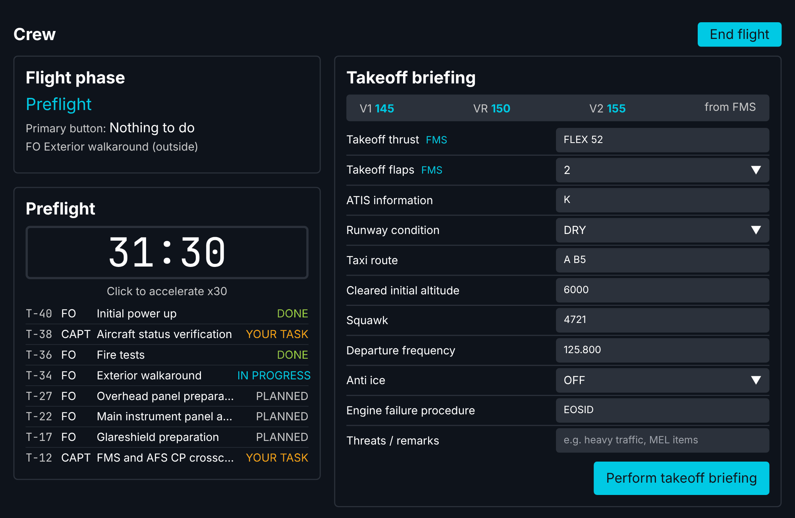

- The **countdown** shows the time to the start. The **schedule** lists the workflows with their time (T-40 is 40
  minutes before the start):
  - **FO** workflows are performed by the first officer: initial power up (batteries, external power), fire tests,
    exterior walkaround, overhead panel, main instrument panel and pedestal, glareshield (flight directors).
  - The **exterior walkaround** takes 6 minutes after the fire tests. The first officer says "I'm going out for the
    walkaround" ("OK!"), is shown *outside* on the Crew page, and comes back with "I'm back from the walkaround, no
    issues found" ("All right, thank you so much!").
  - **CAPT** workflows are **your tasks**, shown in amber: aircraft status verification and the FMS initialization
    with the AFS CP crosscheck. The APU start is also yours.
  - States: PLANNED, IN PROGRESS, DONE, YOUR TASK.
- **Click the countdown** to accelerate it x30, and again to return to the normal pace. It cannot be accelerated
  while a crew member is busy in the cockpit ("Crew busy, the countdown cannot be accelerated"), but it can during
  the walkaround.
- Perform the **takeoff briefing** during the preflight, once the FMS is prepared (see [6. Briefings](#6-briefings)).
  Afterwards, the primary button requests the **COCKPIT PREPARATION** checklist.
- The preflight ends when the countdown reaches 0: the phase becomes **Before pushback or start**.

If you prepare the aircraft yourself, or start from a ready aircraft, press **Skip to takeoff briefing** instead.
Performing the briefing then moves to **Before pushback or start**.

> [!NOTE]
> If you sit in the right seat, the FO workflows become yours and the CAPT ones are performed by the virtual crew
> member.

### 4.2 Takeoff briefing

Fill in the takeoff briefing card and press **Perform takeoff briefing**. You ask "Are you ready for the departure
briefing?", the first officer answers "Go ahead", your voice reads the briefing, ends with "Any questions?" and the
first officer answers "No questions". See [6. Briefings](#6-briefings) for the fields.

The briefing data is also used by the first officer: takeoff flaps (after start flow, taxi checklist) and anti ice
(after start checklist).

### 4.3 Before start and engine start

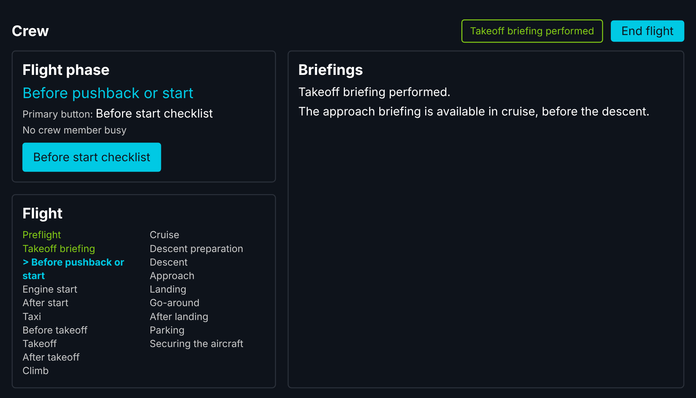

1. If not done during the preflight, the primary button first requests the **COCKPIT PREPARATION** checklist.
   When the doors are closed and you are ready, press the primary button: **BEFORE START** checklist. Respond to each
   item with the primary button (see [5. Checklists](#5-checklists)).
2. Once the checklist is completed and the beacon is ON, the first officer sets the **transponder to AUTO** (before
   start flow, with the SSR policy VATSIM).
3. Start the engines yourself (engine mode selector IGN START, engine masters). The first officer calls each start:
   "Engine *n* start valve open", "Fuel flow", "Engine *n* stable".

### 4.4 After start and flight control check

When the engine mode selector returns to NORM, the first officer performs the **after start flow**: ground spoilers
ARM, flaps to the briefed takeoff setting, autobrake RTO, and the **pitch trim**: the first officer checks the THS
and, if it differs from the takeoff THS of the FMS (computed from the THS FOR of the PERF TO page), moves the pitch
trim switch to set it.

1. Primary button: **AFTER START** checklist (ANTI ICE is checked against your briefing).
2. Primary button: **Flight control check**. You say "Flight control check". Move the sidestick and the rudder pedals
   through their full travel: the first officer announces "Full up", "Full down", "Neutral", "Full left", "Full
   right", "Neutral", then the same for the rudder. The secondary button skips the check.

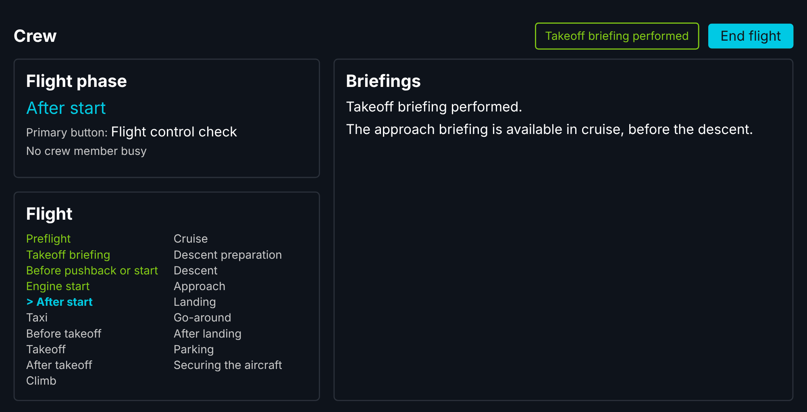

### 4.5 Taxi and brake check

When you release the parking brake and start moving, the phase becomes **Taxi**.

1. Primary button: **Brake check**. You say "Brake check". Press the brake pedals: the first officer checks the
   alternate brake pressure and announces **"Pressure zero"** (or "Please check, I see a discrepancy"). The secondary
   button skips the check.
2. Primary button: **TAXI** checklist. During the checklist the first officer presses **T.O CONFIG** and reads the
   ECAM takeoff memo as a single item ("ECAM memo?" ... "Takeoff, no blue").

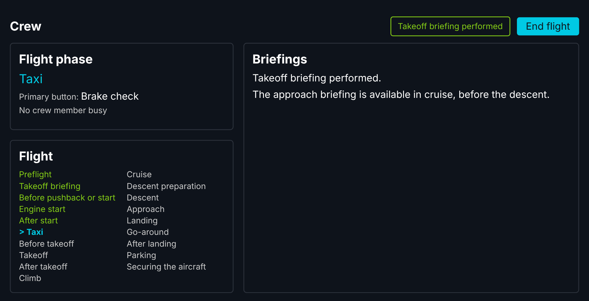

### 4.6 Before takeoff and line-up

At the holding point, press the primary button (**Line-up flow (holding point)**). The first officer performs the
**line-up flow**: strobe ON, nose light T.O, transponder AUTO (SSR policy IVAO), TCAS TA/RA, double cycle of the seat belts signs and "Cabin crew, seats
for takeoff". The phase becomes **Before takeoff**.

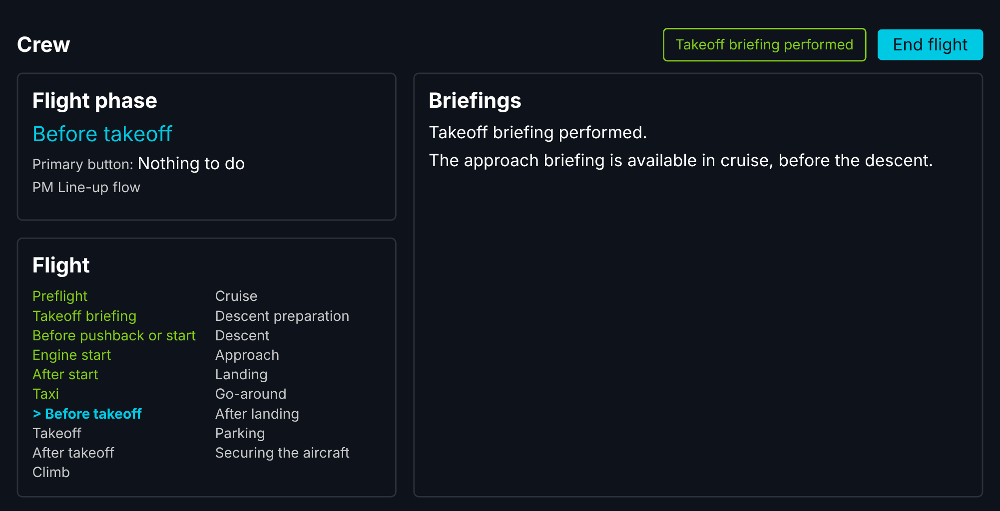

Then press the primary button for the **LINE-UP** checklist.

### 4.7 Takeoff

When cleared, press the primary button: **Announce takeoff**. You say "Takeoff", the first officer turns the landing
lights ON and the nose light to T.O, and the phase becomes **Takeoff**.

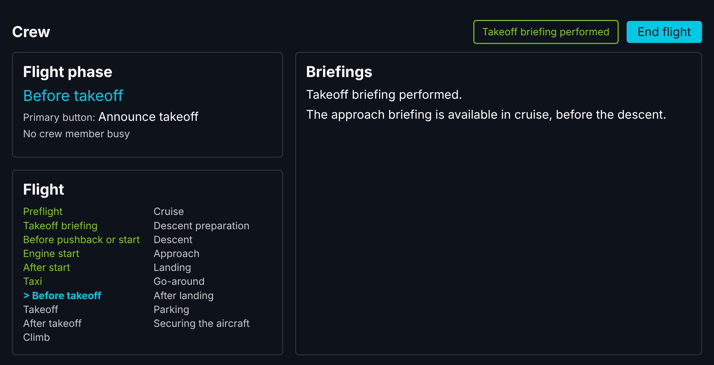

Set the thrust levers to FLX or TOGA. The first officer calls:

- **"Thrust set"**, when the FMA shows the takeoff thrust mode and the N1 has reached the thrust limit
- **"One hundred knots"**, **"V1"**, **"Rotate"**
- **"Positive climb"**, when the aircraft climbs

Then give the orders with the primary button: **Gear up**, **Flaps 1** and **Flaps 0**, at the right speeds. The first
officer executes and confirms. If the speed is not correct for the flaps, the first officer answers "Check speed".

> [!WARNING]
> Before V1, the **secondary button** calls **"Stop!"**: it is a rejected takeoff. You perform the rejected takeoff
> yourself (thrust levers idle, reversers, braking).

When the flaps are retracted, the first officer performs the **after takeoff flow**: ground spoilers DISARM, nose and
runway turnoff lights OFF.

### 4.8 Climb and cruise

- Crossing the **transition altitude** of the FMS, the first officer calls **"Transition"**. Set your altimeter to
  STD (push the baro knob, on the A380 it is pushed for STD and pulled for QNH): you call **"Altimeter standard"** as soon as it is on STD (right away if it already was),
  the first officer sets their own altimeter to STD and replies "Altimeter standard".
- Passing **10000 ft** in climb, the first officer turns the landing lights OFF, and the wing lights OFF if on.
- **"One thousand to go"** is called 1000 ft before the altitude selected on the FCU, in climb and descent.
- The phase becomes **Cruise** when the FMGC enters the cruise, or as soon as the FMA shows **ALT CRZ** or **ALT
  CRZ\*** (e.g. a short flight at a low cruise altitude).
- Nothing else is needed in cruise until the approach briefing.

### 4.9 Approach briefing and descent

In cruise, the **Approach briefing** card appears. Fill it in after preparing the arrival in the FMS and press
**Perform approach briefing** ("Are you ready for the approach briefing?" ... "Go ahead" ... "Any questions?" ... "No
questions"). The phase becomes **Descent preparation** and the first officer sets the **autobrake** as briefed.

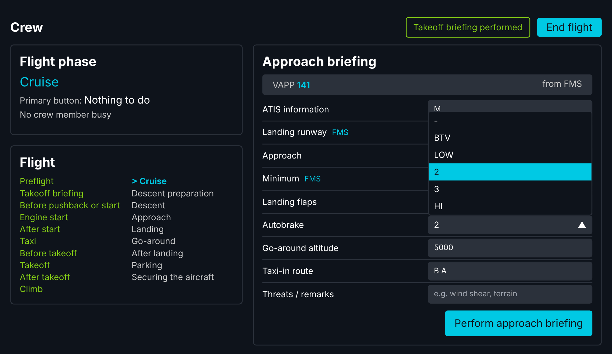

Crossing the **transition level** of the FMS, the first officer calls **"Transition"**. Set your altimeter to the QNH
of the APPR PERF page of the FMS (pull the baro knob): you announce the QNH (e.g. **"QNH one zero one three"**, or "QNH two niner niner
two" in inches) as soon as it is set to that value (any QNH if none is entered in the FMS), the first officer sets
their own altimeter and replies with the same QNH.

Passing **10000 ft** in descent, the first officer turns the landing lights ON, the wing lights ON at night, and calls
"Cabin crew, seats for landing".

### 4.10 Approach and landing

1. Primary button: **APPROACH** checklist (the MINIMUM item is checked against the minimum entered in the FMS, AUTO
   BRAKE against the briefing).
2. Then give the configuration orders with the primary button, at the right speeds: **Flaps 1**, **Flaps 2**,
   **Gear down**, **Flaps 3**, **Flaps full**. With "Gear down", the first officer also arms the ground spoilers,
   turns the runway turnoff lights ON and the nose light to T.O. "Flaps full" is skipped if you briefed landing flaps 3.
3. Primary button: **LANDING** checklist, once the aircraft is in landing configuration (ECAM memo read as one item:
   "Landing, no blue").

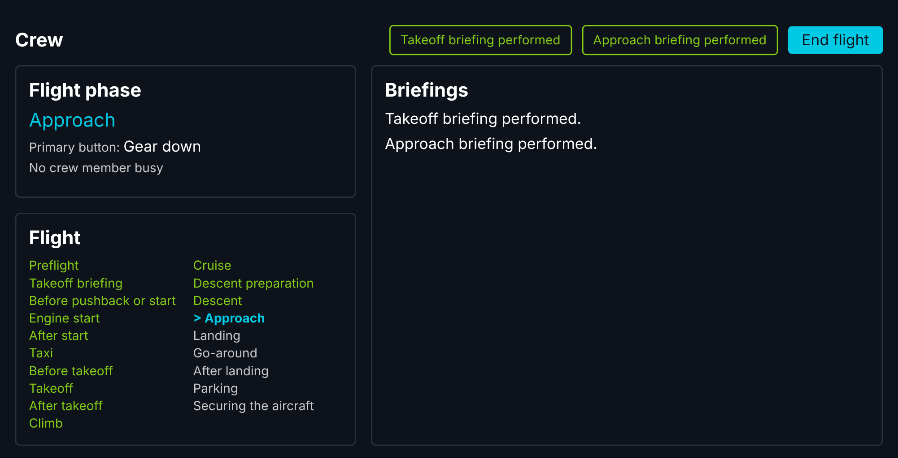

The first officer calls **"Localizer alive"**, **"Glideslope alive"**, **"Speed"** if the speed deviates, and
**"One thousand to go"**. After touchdown: **"Spoilers"**, **"Reverse green"**, **"Decel"** and **"Seventy knots"**.

### 4.11 Go-around

When you set TOGA and the FMGC enters the go-around phase, press the primary button: **"Go around, flaps"**. The first
officer retracts one flaps step and calls **"Positive climb"**; then order **Gear up**, **Flaps 1** and **Flaps 0** as
after a takeoff. The landing checklist will be read again on the next approach.

### 4.12 After landing, parking and securing

When the ground spoilers are disarmed, the speed is below 30 kt and you have turned off the runway (more than 15°),
the phase becomes **After landing** and the first officer performs the **after landing flow**: flaps 0, strobe AUTO,
landing lights OFF, nose light TAXI, TCAS STBY, transponder STBY (SSR policy IVAO), flight directors, LS and ND overlays OFF, **APU
start**.

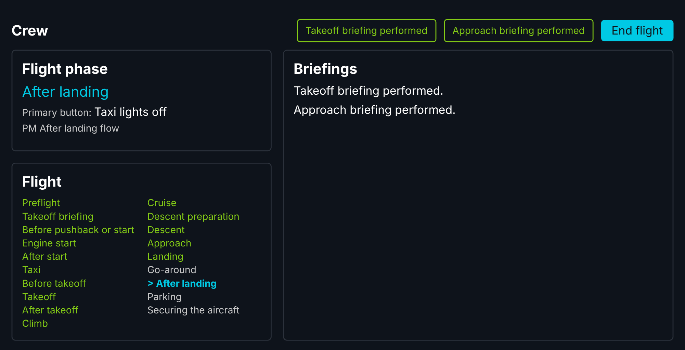

1. Approaching the stand, press the primary button: **"Taxi lights off"**. The first officer turns the nose, runway
   turnoff (with the taxi camera) and wing lights OFF.
2. Set the parking brake: the phase becomes **Parking**. Once the APU is available, the first officer turns the **APU
   bleed ON**.
3. Shut the engines down: the first officer turns the engine and wing anti ice OFF (if on), the **fuel pumps OFF** and
   the transponder to STBY (SSR policy VATSIM). Then primary button: **PARKING** checklist.
4. Primary button: **SECURING THE AIRCRAFT** checklist. The flight ends and the Crew page is ready for a new
   flight.

## 5. Checklists

The first officer reads the normal checklists of the **ECL** on the EWD: it activates the checklist with the ECP,
reads each item, waits for your response, checks the item and completes the checklist. Only the checklists of the ECL
are read.

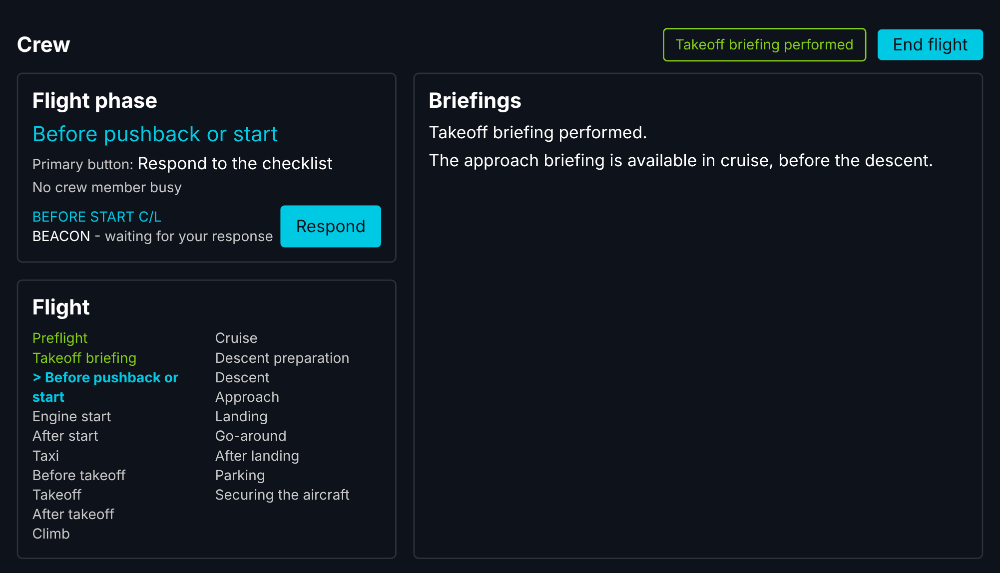

1. When a checklist is available, the primary button requests it (or press the checklist button on the Crew page).
   The first officer announces it, e.g. "Before start checklist".
2. For each item, the first officer reads the challenge ("Beacon?") and the Crew page shows *waiting for your
   response*. Check the item and press the primary button (or **Respond**): your voice gives the response ("On").
3. The first officer checks the item: on the ECL for the items sensed by the aircraft, otherwise in the cockpit or
   against your briefings. If the item is not correct, it says **"Please check, I see a discrepancy"** and the Crew
   page shows the discrepancy in amber. Correct the item: the checklist continues as soon as it is correct, or you
   can respond again.
4. Items whose ECL response ends with **(BOTH)** (e.g. BARO REF, T.O SPEEDS & THRUST, FLIGHT CONTROLS, FLAPS
   SETTING, T.O RWY) are answered by both pilots: you first ("Set"), then the first officer with the same words once
   they have checked the item ("Set").
5. At the end: "... checklist complete".

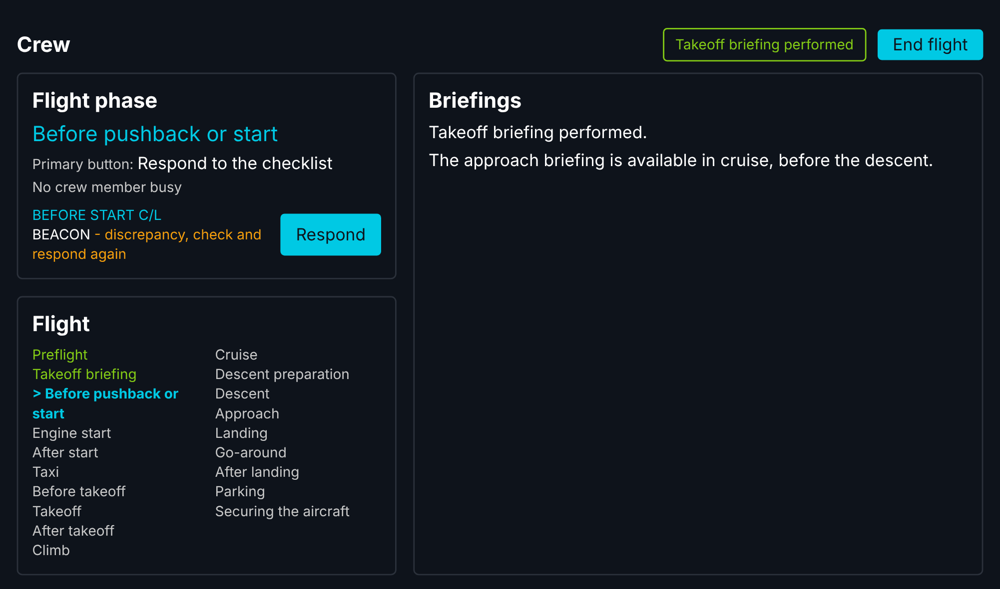

The secondary button stops the checklist being read. It can be requested again with the primary button.

| Checklist             | Available                                                       |
|-----------------------|-----------------------------------------------------------------|
| Cockpit preparation   | preflight or before start, after the takeoff briefing            |
| Before start          | before pushback or start, after the cockpit preparation C/L      |
| After start           | after start or taxi, once the after start flow is done           |
| Taxi                  | taxi, after the flight control check and the brake check         |
| Line-up               | before takeoff, after the line-up flow                           |
| Approach              | descent or approach                                             |
| Landing               | approach, after the approach C/L, in landing configuration       |
| Parking               | parking, engines off                                            |
| Securing the aircraft | after the parking C/L                                           |

> [!NOTE]
> The ECAM memo items of the taxi (T.O) and landing (LDG) checklists are read as a single item: "ECAM memo?" ...
> "Takeoff, no blue" / "Landing, no blue". They are checked together.

## 6. Briefings

Both briefings are cards of the Crew page. Fields marked **FMS** take their value from the FMS (or the SimBrief flight
plan) until you enter another value; clearing the entry returns to the FMS value. Fields with a list are selected
with the arrow, the others are typed. The V speeds and VAPP are shown from the FMS and are not entered again.

### Takeoff briefing

| Field                    | Spoken as                                   | Notes                                       |
|--------------------------|---------------------------------------------|---------------------------------------------|
| Takeoff thrust           | "Takeoff thrust flex five two" / "TOGA"     | FMS (FLEX temperature), e.g. FLEX 52, TOGA  |
| Takeoff flaps            | "Flaps two"                                 | FMS; list 1+F, 2, 3; set by the FO after start |
| ATIS information         | "We have information kilo"                  | one letter                                  |
| Runway condition         | "Runway condition dry"                      | list DRY, WET, CONTAMINATED                 |
| V1, VR, V2               | "Vee one one four five"...                  | from the FMS                                |
| Taxi route               | "Taxi route as per the chart."              | free text, not read word for word           |
| Cleared initial altitude | "Cleared initial altitude six thousand feet"     | e.g. 6000, FL070                            |
| Squawk                   | "Squawk four seven two one"                 | 4 digits                                    |
| Departure frequency      | "Departure frequency one two five decimal eight" | e.g. 125.800                           |
| Anti ice                 | "Anti ice off"                              | list OFF, ENG, ENG + WING; checked in the after start C/L |
| Engine failure procedure | "In case of engine failure, we follow the engine out procedure as briefed." | always spoken |
| Threats / remarks        | "Threats and remarks as discussed."         | free text, spoken if entered                |

### Approach briefing

| Field              | Spoken as                                 | Notes                                          |
|--------------------|-------------------------------------------|------------------------------------------------|
| ATIS information   | "We have information mike"                | one letter                                     |
| Landing runway     | "Landing runway two seven right"          | SimBrief arrival runway by default             |
| Approach           | "Approach I L S"                          | list ILS, GLS, RNP, VOR, NDB, LOC, VISUAL      |
| Minimum            | "Minimum two hundred radio"               | FMS: BARO (MDA) or RADIO (DH)                  |
| Landing flaps      | "Landing flaps full"                      | list 3, FULL; with 3, "Flaps full" is skipped  |
| VAPP               | "Vee app one four one"                    | from the FMS                                   |
| Autobrake          | "Autobrake two"                           | list BTV, LOW, 2, 3, HI; set by the FO         |
| Go-around altitude | "Go around altitude five thousand feet"        |                                                |
| Taxi-in route      | "Taxi in route as per the chart."         | free text                                      |
| Threats / remarks  | "Threats and remarks as discussed."       | free text                                      |

Empty fields are not spoken. The briefings are stored per flight and cleared with **End flight**.

## 7. Callouts

| When                          | First officer                                                    |
|-------------------------------|------------------------------------------------------------------|
| Engine start                  | "Engine *n* start valve open", "Fuel flow", "Engine *n* stable"   |
| Takeoff roll                  | "Thrust set", "One hundred knots", "V1", "Rotate"                 |
| Initial climb, go-around      | "Positive climb"                                                 |
| 1000 ft before the FCU altitude | "One thousand to go"                                           |
| Transition altitude (climb), transition level (descent) | "Transition", then the reply to your altimeter call: "Altimeter standard" / "QNH ..." |
| 10000 ft in descent           | "Cabin crew, seats for landing"                                  |
| Approach                      | "Localizer alive", "Glideslope alive", "Speed"                   |
| Landing roll                  | "Spoilers", "Reverse green", "Decel", "Seventy knots"            |
| Order not possible            | "Check speed"                                                    |

The radio altimeter and minimum callouts are made by the aircraft (FWS), not by the virtual crew.

## 8. What remains your job

As captain and pilot flying you keep the items of the left seat and the decisions of the SOP:

- flying the aircraft, the FCU and the FMS (initialization, performance, approach)
- the APU start before the flight, the engine start and shutdown
- the seat belts signs (except the double cycle of the line-up flow) and the anti ice
- your altimeter setting at the transition altitude and level (the first officer sets their own)
- the nose and runway turnoff lights for the taxi out
- the parking brake, the pushback, the communications with ATC and the cabin
- the rejected takeoff and the go-around decision

## 9. Troubleshooting

| Problem                                    | What to do                                                                                     |
|--------------------------------------------|------------------------------------------------------------------------------------------------|
| The crew does not answer the buttons       | Check the virtual crew is enabled, the sim events are selected in the flyPad and bound in the MSFS controls. Test with **Press button** in the settings. |
| No voices                                  | Check the cockpit volume in the MSFS sound settings. The crew still works silently without its voice pack. |
| "ECL not available, request the checklist again" | The ECAM was not powered or not available. Check the electrical power and request the checklist again. |
| A checklist is not proposed                | Check the conditions in [5. Checklists](#5-checklists), e.g. the after start flow done, the brake check done, the landing configuration. |
| The phase does not match the flight        | Phases follow the aircraft. If a flight was reloaded or interrupted, press **End flight** and start again with **Skip to takeoff briefing**. |
| A switch is not moved by a flow            | Test it in **Settings > Virtual Crew > Test the cockpit controls**.                           |
| The primary button shows "Nothing to do"   | The crew waits for the aircraft: a phase change, a speed, an altitude or the end of a flow.    |

## 10. Reference for external tools

Tools such as SPAD.neXt, AAO or a Stream Deck can drive the crew with local variables instead of sim events:

| Variable                               | Use                                                                    |
|----------------------------------------|------------------------------------------------------------------------|
| `L:A380X_VCREW_PRIMARY_BUTTON`         | Write 1 to press the primary button                                    |
| `L:A380X_VCREW_SECONDARY_BUTTON`       | Write 1 to press the secondary button                                  |
| `L:A380X_VCREW_PHASE`                  | Current phase (0 no flight, 1 preflight ... 19 securing the aircraft)  |
| `L:A380X_VCREW_NEXT_ACTION`            | What the primary button will do                                         |
| `L:A380X_VCREW_CHECKLIST_RUNNING`      | Checklist being read (0 if none)                                       |

The complete list is in `fbw-a380x/src/systems/shared/src/VirtualCrew.ts`. For developers, the architecture is
described in the [module README](../../src/systems/extras-host/modules/virtual_crew/README.md).
